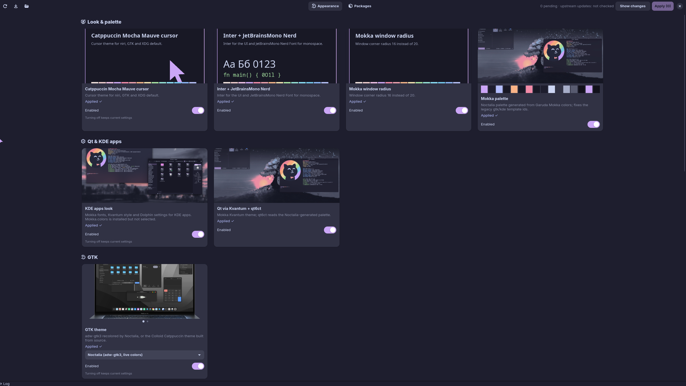

# niri-noctalia-rice

A desktop setup for **CachyOS / Arch Linux** built on the [niri](https://github.com/YaLTeR/niri) scrolling compositor
and the [Noctalia](https://github.com/noctalia-dev/noctalia-shell) shell, styled after
**[Garuda Linux](https://garudalinux.org/) Mokka** (Catppuccin Mocha Mauve).

Noctalia drives the colors. The Garuda Mokka parts (Kvantum theme, fonts, cursor, fish config, Starship prompt,
Fastfetch, app themes, wallpapers) are fetched from Garuda's own upstream repositories at install time, pinned to the
versions Garuda ships, and patched to fit niri + Noctalia. Nothing from Garuda is vendored here.



**Includes:** niri · Noctalia · WezTerm · fish + Starship · greetd/ReGreet login screen · Kvantum/qt6ct · GTK
(adw-gtk3 or Colloid) · AstroNvim · FireDragon · Handy speech-to-text · a GTK4 GUI to manage it all.

## Contents

- [Requirements](#requirements)
- [Install](#install)
- [GUI](#gui)
- [Packages](#packages)
- [Appearance (Mokka components)](#appearance-mokka-components)
- [Command line](#command-line)
- [Your own settings](#your-own-settings)
- [How rice treats your files](#how-rice-treats-your-files)
- [Repository layout](#repository-layout)
- [Notes](#notes)
- [Troubleshooting](#troubleshooting)
- [Credits](#credits)

## Requirements

- CachyOS or another Arch-based distro (`pacman`), a normal user with sudo.
- An up-to-date system: run `sudo pacman -Syu` (or `cachy-update`) first. The installer only runs
  `pacman -S --needed` and never upgrades the system itself.
- For the GUI: Python, PyGObject, GTK4 and libadwaita (installed by the `core` package set).

## Install

```bash
git clone https://github.com/MushroomSquad/niri-noctalia-rice.git
cd niri-noctalia-rice
./install.sh          # asks about optional parts
./install.sh --gui    # or pick packages and components in the GUI
```

Keep the checkout where it is: the GUI and its launcher (**niri-noctalia-rice** in the app menu) run from it.

The installer has two phases:

1. **Packages.** Installs the package sets from [`mokka/packages.toml`](mokka/packages.toml): `core` and `shell`
   always, the rest as you answer. Without a TTY, or with `--yes`, it uses each set's default.
2. **Appearance.** Runs `python -m rice apply --defaults --yes` to apply the Mokka components. A component whose
   packages are missing is skipped with `needs ...`. It never installs packages behind your back.

After the first login into niri, run `noctalia msg templates-apply`. Noctalia steps wait in `run_pending` until
`python -m rice apply --defaults` (or **Apply** in the GUI) runs inside a session with Noctalia running.

To update, run `./install.sh update`. It is the same as `--yes`, but first does `git pull --ff-only` and restarts
itself. OS updates go through `cachy-update`; the installer enables its tray applet and daily check.

Files the installer overwrites are kept as `*.bak-<timestamp>`.

<details>
<summary><b>All installer flags</b></summary>

| Flag | Effect |
|---|---|
| `--yes` | No questions, use defaults |
| `--gui` | Run phase 1, then open the GUI instead of `apply --defaults` |
| `--no-pkgs` | Skip phase 1 (needs `python` already installed) |
| `--no-mokka` | Skip phase 2 |
| `--no-wallpapers` | Don't copy wallpapers |
| `--no-<set>` / `--<set>` | Skip or include any package set from `rice packages list`; an unknown id is an error |
| `--no-greeter`, `--no-handy`, `--no-firedragon`, `--firedragon` | Old flags, mapped to the sets of the same name |
| `--no-nvim`, `--no-agents` / `--nvim`, `--agents` | Exclude or include these components (and the `nvim` package set) |
| `--fish-theme` | Keep Catppuccin Mocha for fish syntax highlighting |
| `--only greeter,handy,firedragon,podman` | Run only these install steps: no questions, no config copy, no rice. `--only pkgs` was removed, use `python -m rice packages install <ids>` |
| `--print-plan` | Ask the questions, print `sets: ...` / `apply: ...` and exit before sudo or any file write |
| `RICE_NO_RUN=1` | Pass `--no-run` to the final `rice apply` (write files, skip recipe commands) |

</details>

## GUI

```bash
python -m rice gui
python -m rice.gui --tab packages   # open on the Packages tab
```

- **Appearance:** Mokka components as cards with large previews (click to open fullscreen), the palette, variant
  dropdowns and a state line: *Applied*, *Needs apply*, *Hand-edited*, *Waiting for Noctalia*, *Needs packages*. The
  header shows how many changes are pending and whether upstream has updates, next to **Apply (N)**. Also: check
  for updates, show changes (diff), open the custom folder.
- **Packages:** package sets by group, each *Installed*, *Partially installed* (lists what is missing) or *Not
  installed*. **Install** and **Remove** open a terminal where sudo is asked; the GUI reads the result when the
  terminal closes (*Done*, *Failed*, *Cancelled*, *Terminal did not start*).

The terminal is picked in this order: `xdg-terminal-exec`, `$TERMINAL` (not `footclient`), then the first of WezTerm,
kitty, foot, Alacritty, Konsole.

## Packages

Every package lives in [`mokka/packages.toml`](mokka/packages.toml) as a **set**:

| Group | Sets |
|---|---|
| Base | `core`, `shell` |
| Theme | `gtk-theme`, `fonts`, `icons`, `qt-theme`, `cursors`, `sassc` |
| Apps | `greeter`, `handy`, `firedragon`, `nvim`, `micro`, `telegram`, `filezilla`, `clash-verge`, `spotify` |
| Dev | `dev` (Node.js, k9s, rootless Podman) |

State always comes from the live system, so software installed by hand or by an older installer is detected:

- one `pacman -T` call for all sets, which also resolves `provides`;
- `any_of`: alternatives that satisfy each other (`firedragon` or `firedragon-catppuccin-bin`);
- `cmds`: a command that counts as the package, for tools installed outside pacman (cargo, `~/.local/bin`);
- `installed_if`: a command, file or enabled systemd unit (greetd, the Handy AppImage).

Sets with an install step (`greeter`, `handy`, `firedragon`, `dev`) run `install.sh --only <step>` after their
packages.

```bash
python -m rice packages list
python -m rice packages status
python -m rice packages install firedragon nvim
python -m rice packages remove telegram       # only optional app sets
```

## Appearance (Mokka components)

| Component | What it changes |
|---|---|
| `palette` | Mokka palette and Noctalia templates |
| `qt`, `kde-apps` | Kvantum Mokka, qt6ct, KDE app colors (Dolphin, …) |
| `gtk` | Noctalia/adw-gtk3 (default) or Colloid Catppuccin |
| `fonts`, `cursor`, `niri-look` | Inter + JetBrainsMono Nerd Font, Catppuccin Mocha Mauve cursor, 16 px window radius |
| `fish`, `starship` | Garuda fish config; Starship Mokka (default), Garuda or live Noctalia colors |
| `fastfetch`, `wallpapers` | Fastfetch Mokka or the repo preset; Mokka or Garuda wallpapers |
| `konsole-kate`, `bat`, `micro` | App themes, applied only if the app is installed |
| `nvim`, `agents` | AstroNvim; Claude Code / Codex agents |

Recipes are declarative TOML files in [`mokka/components/`](mokka/components). They never install packages; they
declare `needs` (package set ids). `apply --install-needs` installs missing needs first.

`apply --defaults` applies components that are already on, plus default components that have no state yet. A
component you turned off stays off. Turning one off keeps its current settings and leaves apps installed.

Upstream sources are pinned in [`mokka/upstream.lock.toml`](mokka/upstream.lock.toml) and cached in
`~/.cache/niri-noctalia-rice/upstream`, so once fetched everything works offline. Updates are checked on demand,
with a diff shown before anything changes.

## Command line

Run from the repository root:

```bash
python -m rice status                      # components and their state
python -m rice status --remote             # also check upstream for updates
python -m rice apply --defaults --dry-run  # preview changes, no network or builds
python -m rice apply --defaults --yes
python -m rice apply --defaults --without nvim,agents --yes
python -m rice apply gtk --variant gtk=colloid --yes
python -m rice apply starship --variant starship=noctalia --yes
python -m rice disable gtk
python -m rice fetch --defaults
python -m rice update                      # show upstream diff, rebuild what changed
python -m rice lock --latest               # re-pin sources
```

Colloid is built by running its upstream `install.sh`, only when you choose that variant. libadwaita apps ignore it.

## Your own settings

Put your changes in **`~/.config/rice-custom/`**. It is never overwritten, backed up or tracked; rice only creates
missing examples from [`mokka/custom-skel/`](mokka/custom-skel). The GUI button **Open custom folder** opens it.

| File | Loaded |
|---|---|
| `fish/*.fish` | Last, in name order, so they can override Garuda aliases |
| `niri.kdl` | After `noctalia.kdl`, so it can override keybindings. A typo breaks the whole niri config: check with `niri validate` |
| `wezterm.lua` | Before `return config`, e.g. `config.font_size = 14` |
| `gtk3.css`, `gtk4.css` | After the main GTK 3 / GTK 4 styles |
| `starship.toml` | Replaces the whole prompt via `STARSHIP_CONFIG` (see `starship.toml.example`) |

## How rice treats your files

```bash
python -m rice owned                               # files rice manages, relative to ~
python -m rice refresh .config/niri/cfg/misc.kdl   # restore the repo version (with a backup)
```

- Whole files are tracked by hash. If you edit one by hand, rice keeps your version unless you pass `--force`.
- Shared configs (`kdeglobals`, `dolphinrc`, `qt6ct.conf`, `kvantum.kvconfig`, `micro/settings.json`, Noctalia
  `settings.toml`) only get the keys rice needs. Everything else stays yours.
- Seed files (Neovim `lazy-lock.json`, the Noctalia Starship variant) are copied once and not tracked.
- Re-running `install.sh` keeps files rice owns (`kept (owned by rice): <path>`).

## Repository layout

| Path | What |
|---|---|
| `install.sh` | Installer: package phase, appearance phase, `--only` steps |
| `rice/` | Engine, CLI and GUI (Python stdlib + PyGObject) |
| `mokka/components/` | Declarative recipes, one per component |
| `mokka/packages.toml` | Package sets |
| `mokka/upstream.lock.toml` | Pinned upstream sources |
| `mokka/files/`, `mokka/previews/`, `mokka/custom-skel/` | Variant files, GUI previews, custom-folder examples |
| `home/` | Base configs: niri, Noctalia, WezTerm, GTK, fish extras |
| `nvim/`, `agents/` | AstroNvim config, Claude Code / Codex agents |
| `etc/greetd/` | greetd + ReGreet login screen |
| `etc/systemd/`, `etc/dracut.conf.d/` | 120 s root mount timeout in the initrd |
| `wallpapers/`, `handy/` | Repo wallpapers, Handy settings template |
| `docs/mokka/` | Specs and plans |
| `tests/` | `python -m unittest discover -s tests` |

## Notes

- **Monitors** are set up by `~/.local/bin/niri-autodisplay` when niri starts: native resolution, highest refresh
  rate, VRR, scale by DPI, left to right. Remove the `AUTOGEN` line in `display.kdl` to pin your own layout
  (rotation isn't detected; see `display.kdl.example`). The greeter generates outputs from the connected ports.
- **Apps launched from Noctalia** run as separate systemd units (`launch_apps_as_systemd_services`), so under memory
  pressure systemd-oomd kills the hungry app, not the whole shell.
- **Boot:** CachyOS sets `DefaultTimeoutStartSec=15s`, which also applies in the initrd. After a hard power-off,
  btrfs may need longer to mount root and boot drops to emergency mode. The installer gives `sysroot.mount` 120 s and
  rebuilds the initramfs (`limine-update` or `dracut --regenerate-all`).
- **Polkit:** Noctalia's built-in agent is used; `polkit-kde-agent` is not installed.
- **FireDragon** replaces Firefox (removed after install); Mod+B opens it. Profiles are not migrated.
- **Handy** is downloaded from GitHub (latest, or `HANDY_VERSION=x.y.z`) into `~/.local/opt/handy`. Ctrl+Space is
  push-to-talk; pick a speech model in Handy's window on first start.
- **Fastfetch** shows its logo through the kitty graphics protocol, enabled in WezTerm.
- **Fingerprint** on the lock screen is enabled but needs `fprintd` and `fprintd-enroll`.
- Noctalia plugins, `fish_variables`, the old v4 `settings.json`, caches and state are not migrated.

## Troubleshooting

- **404 or database errors while installing:** the package database is stale. Run `cachy-update` and try again.
- **`/var/lib/pacman/db.lck`:** make sure pacman isn't running, then `sudo rm /var/lib/pacman/db.lck`.
- **Noctalia steps stay pending:** Noctalia must be running; run `python -m rice apply --defaults` inside the session.
- **Noctalia "Legacy setting" banner:** run `noctalia config validate` and fix the listed keys in
  `~/.config/noctalia/config.toml`. The repo copy is kept current, but rice doesn't overwrite your live file.

## Credits

- **[Garuda Linux](https://garudalinux.org/)** for the Mokka look this setup is built on:
  [garuda-mokka](https://gitlab.com/garuda-linux/themes-and-settings/settings/garuda-mokka),
  [garuda-fish-config and garuda-starship-prompt](https://gitlab.com/garuda-linux/pkgbuilds),
  [garuda-wallpapers](https://gitlab.com/garuda-linux/themes-and-settings/artwork/garuda-wallpapers).
  This project is not affiliated with Garuda Linux.
- [Catppuccin](https://github.com/catppuccin): KDE, Konsole, bat, micro and cursor themes.
- [niri](https://github.com/YaLTeR/niri), [Noctalia](https://github.com/noctalia-dev/noctalia-shell),
  [CachyOS](https://cachyos.org/).
- [Colloid GTK theme](https://github.com/vinceliuice/Colloid-gtk-theme),
  [done](https://github.com/franciscolourenco/done), [AstroNvim](https://astronvim.com/),
  [Handy](https://github.com/cjpais/Handy).
- Repo wallpapers come from [wallhaven](https://wallhaven.cc/).

## License

[MIT](LICENSE) for the code and configs in this repository. Upstream themes, wallpapers and configs fetched at
install time keep their own licenses.
